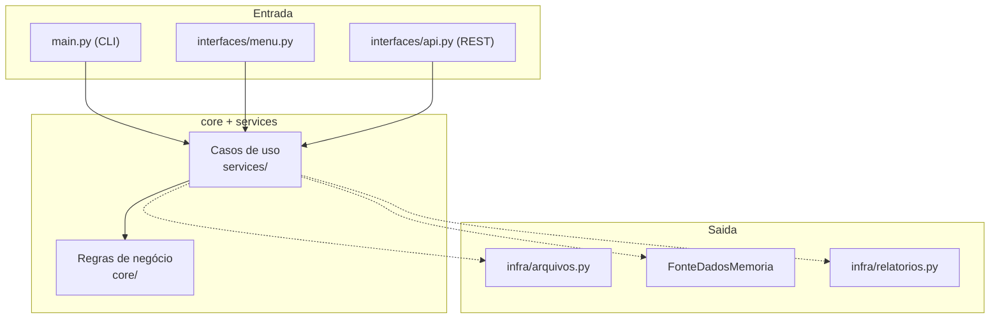

# Aula 20 — Arquitetura hexagonal e fechamento do curso

## Objetivo

Nesta aula você vai:

- Dar nome ao padrão que o curso construiu ao longo dos Módulos 5 a 7
- Visualizar o `core` como centro do sistema, cercado por adaptadores
- Revisar o percurso completo do curso, do dado hardcoded à API REST
- Entender o que a trilha (Fases 2 e 3) vai construir em cima desta base

## 1. O que construímos sem dar nome

Olhe para trás:

- `core` nunca importou `infra` nem `interfaces`
- `services` só conhece abstrações (`FonteDados`, `GeradorRelatorio`)
- `interfaces` (CLI, menu, API) decide **como entrar**, nunca **o que fazer** com os
  dados
- `infra` decide **de onde vêm** e **para onde vão** os dados

Cada peça foi motivada por um requisito concreto — nunca por "achar bonito". Isso tem
nome.

## 2. Arquitetura hexagonal (ports & adapters)

O nome vem do desenho: o núcleo fica no centro, e cada lado do "hexágono" é uma porta —
de entrada (quem aciona o sistema) ou de saída (o que o sistema aciona). O código de
fora se adapta ao contrato do núcleo, nunca o contrário.

!!! note "Você já usava metade do vocabulário"

    "Porta" é a ABC (`FonteDados`, `GeradorRelatorio`). "Adaptador" é a classe concreta
    (`FonteDadosArquivos`, `RelatorioJson`, `interfaces/menu.py`). Você não aprendeu um
    conceito novo agora — aprendeu o nome de um conceito que já usava desde a Aula 13.

## 3. Checklist de portabilidade

Antes de adicionar qualquer coisa nova ao projeto, pergunte:

| Pergunta                                                    | Se a resposta for "sim"                     |
| ------------------------------------------------------------ | -------------------------------------------- |
| Preciso mudar `core/` para adicionar essa interface?         | Alguma regra vazou para fora do núcleo       |
| Preciso mudar `services/` para trocar CSV por outra fonte?    | O service está acoplado a uma implementação  |
| Meu teste de negócio precisa de arquivo em disco?             | Falta uma fonte em memória equivalente       |

Se todas as respostas forem "não", a arquitetura está fazendo o trabalho dela.

## 4. Panorama do curso

| Fase / Módulo                             | Aulas | O que mudou no DataProcessor                              |
| ------------------------------------------ | ----- | ------------------------------------------------------------ |
| Fase 1 — Fundamentos                       | 01–05 | Script único, dados em memória, primeiro pipeline             |
| Módulo 5 — Arquitetura e organização       | 06–10 | Camadas `core`/`infra`/`services`, sem mudar comportamento    |
| Módulo 6 — POO aplicada                    | 11–15 | Entidades, ABCs, polimorfismo, CLI e logging                  |
| Módulo 7 — Interfaces e portas de entrada  | 16–20 | Menu interativo, isolamento de portas, trailer REST           |

## 5. O que vem depois

- **Fase 2 — Desenvolvimento Web com FastAPI** (Aulas 21–25): transforma
  `interfaces/api.py` em uma API real, com múltiplos endpoints, validação e tratamento
  de erros HTTP.
- **Fase 3 — Banco de Dados com SQLAlchemy/PostgreSQL**: substitui `FonteDadosArquivos`
  por uma fonte que lê de banco — sem mudar `core` nem `services`, exatamente como você
  já fez ao criar `FonteDadosMemoria` na Aula 14.

## Entrega do módulo

Ao final das Aulas 16–20, o DataProcessor possui:

- um menu interativo em texto, com estado de sessão e tratamento de erros;
- uma porta de entrada isolada e testável, sem `input()`/`print()` misturados à lógica;
- um endpoint REST de demonstração usando FastAPI;
- um diagrama e um vocabulário para explicar por que a arquitetura foi construída assim.

## Resumo

O curso termina onde prometeu: um sistema CLI funcional, construído do zero, com uma
arquitetura que sobrevive à troca da interface. A próxima fase da trilha não vai pedir
para reconstruir o `core` — vai pedir para dar a ele mais uma porta de entrada.
